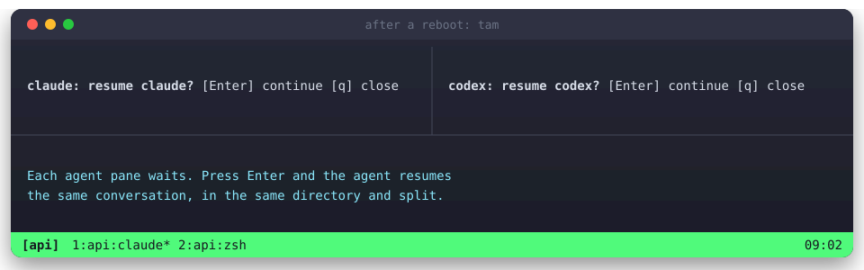

<p align="center">
  
</p>

<h1 align="center">tam</h1>

<p align="center">
  <b>Run your coding agents in tmux. Reboot. Get every session back.</b><br>
  Claude Code · Codex · Gemini · Qwen · OpenCode · Crush · Copilot · Cursor · goose · Aider · Amp
</p>

---

You have five agents working in five repos. Then the machine restarts, and you spend ten minutes finding each conversation again.

With tam, you run `tam`, press Enter in each agent pane, and every agent continues the same conversation, in the same directory, in the same split. Until then, a sidebar shows which agents are working and which are waiting for you.

tam is glue: it wires together tmux, fzf and your agents' own resume commands, and adds only what they lack. ([Why not tmux-resurrect?](docs/how-it-works.md#why-not-tmux-resurrect))

## Install

```sh
brew install kschulst/tap/tam
tam setup
```

`tam setup` adds one line to `~/.tmux.conf`, adds tam's hooks to Claude Code, and picks a default agent from the ones you have installed.

## Use

```sh
cd ~/code/my-project
tam
```

| Keys | Does |
|---|---|
| `⌥ a` | New agent. Pick the directory; `Enter` opens a new window, `Ctrl+v` / `Ctrl+s` a split right / below, `Tab` picks another agent. |
| `⌥ t` | New terminal (no agent), with the same picker |
| `⌥ s` | Move focus to the sidebar, and back |
| `⌥ S` | Show or hide the sidebar in every window |
| `⌥ h` | Cheat sheet |
| `⌥ q` | Quit tam. tmux and the agents keep running; `tam` attaches again. |
| `Ctrl+b → .` | Move the window to another session |

Every key except `⌥ q` also works as `Ctrl+b` followed by the letter (`⌥ q` is tmux's own `Ctrl+b → d`). The `⌥` keys need Option to send Meta (iTerm2: Profiles → Keys → Left Option key: Esc+).

The sidebar is a column on the left of every window. It lists sessions and windows, with each agent's status (`working`, `waiting`), what runs in each window and its git branch. Enter or a double click goes to a window, `Ctrl+r` renames, `Ctrl+x` closes, and `+ terminal` on a session's line opens a terminal in the directory of that session's agent.

Already have Claude running in a plain terminal? Type `! tam adopt` in it, and it moves into tam.

## After a reboot

<p align="center">
  
</p>

Run `tam`. Sessions, windows, splits and directories come back. Agent panes wait for Enter, so twenty agents do not all start at once.

## Built on

| | |
|---|---|
| [tmux](https://github.com/tmux/tmux) | Keeps terminals running in sessions and windows, but only until the machine restarts. tam writes the layout and each pane's agent to disk, so `tam` can rebuild it. |
| [fzf](https://github.com/junegunn/fzf) | Fuzzy finder. Powers the directory picker, the sidebar and `tam move`. |
| [zoxide](https://github.com/ajeetdsouza/zoxide) | Optional. Adds the directories you use most to the picker. |
| Your agents | tam calls each agent's own resume command. Claude Code's hooks report the exact session and its status. |

## More

- [Agents](docs/agents.md): the built-in agents, changing the default, adding your own
- [How it works](docs/how-it-works.md): what tam saves, how restore works, the hooks it installs

Without Homebrew: `uv tool install git+https://github.com/kschulst/tam`, then `tam setup`.

## Develop

```sh
just setup     # uv, just, gh and the Python environment
just dev-on    # `tam` and the tmux keys run this checkout; `just dev-off` goes back to Homebrew
just check     # lint and tests
just release   # tag, GitHub Release and Homebrew formula (patch; or minor, major)
```

`just` lists every task.
