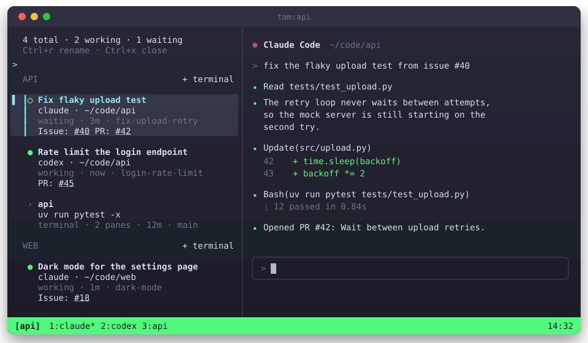

<p align="center">
  
</p>

<h1 align="center">tam</h1>

<p align="center">
  <b>Run your coding agents in tmux. Reboot. Get every session back.</b><br>
  Claude Code · Codex · Gemini · Qwen · OpenCode · Crush · Copilot · Cursor · goose · Aider · Amp
</p>

---

You have five agents working in five repos. Then the machine restarts, and you spend ten minutes finding each conversation again.

With tam, you run `tam`, press Enter in each agent pane, and every agent continues the same conversation, in the same directory, in the same split. Until then, a sidebar shows which agents are working and which are waiting for you.

tam is glue: it wires together tmux, fzf and your agents' own resume commands, and adds only what they lack. ([Why not tmux-resurrect?](docs/how-it-works.md#why-not-tmux-resurrect))

## Install

```sh
brew install kschulst/tap/tam
tam setup
```

`tam setup` adds one line to `~/.tmux.conf`, adds tam's hooks to Claude Code, and picks a default agent from the ones you have installed.

## Use

```sh
cd ~/code/my-project
tam
```

`tam` attaches to the tmux server, or starts it and restores the saved sessions after a reboot.

### Keys

| Keys | Does |
|---|---|
| `⌥ a` | New agent. Pick the directory; `Enter` opens a new window, `Ctrl+v` / `Ctrl+s` a split right / below, `Tab` picks another agent. |
| `⌥ t` | New terminal (no agent), with the same picker |
| `⌥ s` | Move focus to the sidebar, and back |
| `⌥ S` | Show or hide the sidebar in every window |
| `⌥ w` | Close the window marked in the sidebar, after asking |
| `⌥ /` | Run a tam command, such as `mcp install`, in a popup. Up gives earlier ones. |
| `⌥ h` | Cheat sheet |
| `⌥ q` | Quit tam. tmux and the agents keep running; `tam` attaches again. |
| `Ctrl+b → .` | Move the window to another session |

Every key except `⌥ q` and `⌥ w` also works as `Ctrl+b` followed by the letter (`⌥ q` and `⌥ w` are tmux's own `Ctrl+b → d` and `Ctrl+b → &`). The `⌥` keys need an Option key that sends Meta. In iTerm2: Settings → Profiles → Keys → Right Option key: Esc+. The left Option key then keeps typing `@ [ ] { }` on a Norwegian or German keyboard. `tam setup` tells you whether your profile has it.

### Sidebar

The sidebar is a column on the left of every window. It lists each session, with a card for each of its windows:

- An agent's card is named after what the agent is working on (the title it sets, such as Claude's), with its status: `working`, or `waiting` for you. An agent you started by hand in a tam window gets an agent's card too.
- A terminal's card shows the program running in it, or its directory.
- Each card has the git branch, and a line with up to three open issues and pull requests, such as `Issue: #40  PR: #42`: the branch's own PR, those named in the agent's title, and those the agent has shown. Cmd+click opens one. This needs [gh](https://cli.github.com).
- The window you are in has a coloured bar. One click on a card goes to that window. The arrow keys mark a card without going there; `Enter` goes to the marked one and `⌥ w` closes it.
- `+ terminal` on a session's line opens a terminal in the directory of that session's agent, next to the agent's window.
- `Ctrl+r` renames the marked window or session. A renamed card keeps its name instead of following the agent's topic. `Ctrl+x` twice closes it.

### Commands

| Command | Does |
|---|---|
| `tam` | Attach, or start tmux and restore the saved sessions |
| `tam new [agent]` | New agent in a new window or split |
| `tam term` | New terminal |
| `tam adopt` | Move an agent session from a plain terminal into tam |
| `tam agent [name]` | List the installed agents, or set the default |
| `tam move` | Move the current window to another session |
| `tam mcp install` | Let your agents work with tam (see below) |
| `tam setup` | Install the tmux config line and the agent hooks |

Already have Claude running in a plain terminal? Type `! tam adopt` in it, and it moves into tam.

## Agents that work with tam

`tam mcp` is an MCP server, so your agents can work with tam's windows themselves. Register it with every installed agent (Claude Code, Codex, Gemini):

```sh
tam mcp install
```

or `⌥ /` and `mcp install`. `tam mcp uninstall` removes it again. Then you can ask an agent, for example, to start a Codex agent on the API in a split, to tell the agent in the web window that the API has changed, or to close the windows that are done.

| Tool | Does |
|---|---|
| `list_windows` | Sessions and windows: agent, status, topic, directory, branch, open issues and PRs |
| `new_agent` | Start an agent in a directory, in a new window or a split |
| `new_terminal` | Open a shell in a directory, in a new window or a split |
| `rename` | Rename a window or a session |
| `switch_to` | Show a window to you |
| `send_text` | Type text into another window's agent |
| `close_window`, `close_session` | Close a window or a session |

New windows open in the background, so your view does not move. The agent asks you before each call, as for any tool. Closing its own window or session, or typing into its own pane, also needs `self`, so an agent does not do that by mistake.

## After a reboot

<p align="center">
  
</p>

Run `tam`. Sessions, windows, splits and directories come back. Agent panes wait for Enter, so twenty agents do not all start at once.

## Built on

| | |
|---|---|
| [tmux](https://github.com/tmux/tmux) | Keeps terminals running in sessions and windows, but only until the machine restarts. tam writes the layout and each pane's agent to disk, so `tam` can rebuild it. |
| [fzf](https://github.com/junegunn/fzf) | Fuzzy finder. Powers the directory picker, the sidebar and `tam move`. |
| [zoxide](https://github.com/ajeetdsouza/zoxide) | Optional. Adds the directories you use most to the picker. |
| Your agents | tam calls each agent's own resume command. Claude Code's hooks report the exact session and its status. |

## More

- [Agents](docs/agents.md): the built-in agents, changing the default, adding your own
- [How it works](docs/how-it-works.md): what tam saves, how restore works, the hooks it installs

Without Homebrew: `uv tool install git+https://github.com/kschulst/tam`, then `tam setup`.

## Develop

```sh
just setup     # uv, just, gh and the Python environment
just dev-on    # `tam` and the tmux keys run this checkout; `just dev-off` goes back to Homebrew
just check     # lint and tests
just release   # tag, GitHub Release and Homebrew formula (patch; or minor, major)
```

`just` lists every task.
