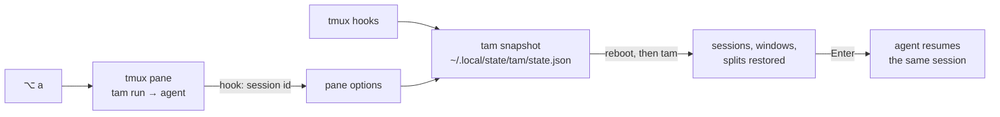

# tam

Run coding agents (Claude Code, Codex, Gemini, …) in tmux, and get every session back after a reboot.

tam is glue. It combines tools you may already use, so that restarting your machine no longer means finding and reopening each agent conversation by hand. Run `tam`, press Enter in each agent pane, and you are back where you were.

## Install

```sh
uv tool install git+https://github.com/kschulst/tam
tam setup
```

`tam setup` offers to install missing tools with Homebrew, adds one line to `~/.tmux.conf`, adds tam's hooks to `~/.claude/settings.json`, and picks a default agent.

## Use

| Keys | Does |
|---|---|
| `tam` | Restore after a reboot and attach. In a project directory, go to that project's session. |
| `⌥ a` or `Ctrl+b → a` | New agent in a new window. Pick the directory; `Tab` picks another agent. |
| `Ctrl+b → A` | New agent in a split |
| `⌥ s` or `Ctrl+b → s` | Sidebar: sessions and agents with status (`working`, `waiting`). Enter switches, the footer button closes. |
| `Ctrl+b → .` | Move the window to another session |
| `⌥ h` or `Ctrl+b → h` | Cheat sheet |
| `tam adopt` | Move a Claude session running outside tmux into tam. Inside that session: `! tam adopt`. |
| `tam agent codex` | Change the default agent |

The `⌥` keys need Option to send Meta (iTerm2: Profiles → Keys → Left Option key: Esc+).

## Built on

| Tool | What it is | What tam uses it for |
|---|---|---|
| [tmux](https://github.com/tmux/tmux) | Terminal multiplexer: sessions, windows and panes that keep running when you detach. | Runs every agent. Its hooks tell tam when to save the layout. |
| [fzf](https://github.com/junegunn/fzf) | Fuzzy finder for lists in the terminal. | The directory picker, the sidebar, `tam move` and `tam adopt`. |
| [zoxide](https://github.com/ajeetdsouza/zoxide) | Remembers the directories you use most. Optional. | Adds those directories to the picker. |
| Agent CLIs | Claude Code, Codex, Gemini CLI, Qwen Code, OpenCode, Crush, Copilot CLI, Cursor, goose, Aider, Amp. | Each has its own way to resume a session; tam calls it. [Agents →](docs/agents.md) |
| Claude Code hooks | Commands Claude Code runs on events such as session start. | Report the session id and status of each pane, so tam resumes the right conversation. |

## How it works



tam saves the tmux layout and each pane's agent and session id whenever tmux changes. After a reboot, `tam` rebuilds the sessions; agent panes wait for Enter, so twenty restored agents do not all start at once. [Details →](docs/how-it-works.md)

## Develop

```sh
uv run pytest
```

The tests run against an isolated tmux server.
