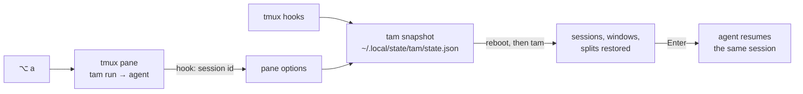

# How it works

## Why not tmux-resurrect

tmux keeps sessions, windows and running programs in the memory of its server process. It writes nothing to disk, so a reboot ends all of it. [tmux-resurrect](https://github.com/tmux-plugins/tmux-resurrect) and [tmux-continuum](https://github.com/tmux-plugins/tmux-continuum) fill that gap for layouts, and for the layout alone they would be enough. For agents they are not:

- **The conversation.** resurrect restarts a program with the command line it was started with. A pane started with `claude` gets `claude` again: an empty conversation. The session id is not on the command line, and it changes during a session (`/clear`, `/resume`). tam gets the id from the agent's hook and stores it on the pane.
- **Timing.** continuum saves every 15 minutes, so a window opened since the last save is lost. tam saves on every change.
- **Start-up.** resurrect starts every saved program at once. tam's agent panes wait for Enter.
- **Shutdown.** Panes that close before tmux exits could be saved as removed. tam ignores those closes (see [Shutdown](#shutdown)).

Saving and restoring the layout is about 250 lines in tam ([state.py](../src/tam/state.py)). The agent part is what no existing tool covers.

## Saving

`tam setup` adds `run-shell "tam tmux-init"` to `~/.tmux.conf`. `tam tmux-init` registers tmux hooks (new window, split, close, rename, layout change, switching, moving windows between sessions). Each runs `tam snapshot`, which writes the whole tmux server to `~/.local/state/tam/state.json`: sessions, windows with their layouts, and for each pane its directory and agent. The previous version is kept as `state.prev.json`.

An agent pane runs `tam run`, which starts the agent and stores on the pane:

| Pane option | Holds |
|---|---|
| `@tam_harness` | The agent |
| `@tam_session_id` | The agent's session id, set by its hook |
| `@tam_status` | `running`, `working`, `waiting`, `exited` or `stopped` |

When the agent exits, `tam run` keeps the pane and waits: Enter resumes, `q` closes.

## Sidebar

The sidebar is a pane running `tam sidebar --pane` (fzf) on the left of every window, 44 columns wide. tam recognises it by that start command. It is saved and restored like any pane, so the saved layout keeps its column.

Showing or hiding is one setting for all windows: `sidebar = "shown"` or `"hidden"` in `config.toml`, copied to the tmux option `@tam_sidebar_shown`. After a new window, a new session, a resize or a closed pane, a tmux hook runs `tam sidebar --ensure`: it adds the sidebar to windows without one, sets its width back to 44 columns, removes it everywhere when hidden, and closes a window with only its sidebar left. The hooks check the option in tmux first, so with the sidebar hidden no Python runs. After a closed pane, `--ensure` waits two seconds, for the same reason as saving does (see [Shutdown](#shutdown)).

A visible sidebar reloads every 2 seconds. A sidebar in a window no client shows checks that with one tmux call and does not reload. The command a terminal pane runs comes from one `ps` call per reload, because tmux gives only the program's name.

## Restoring

After a reboot no tmux server runs. `tam` starts one and recreates every saved session that does not exist, with its windows, splits and directories, then attaches. Shell panes get a shell. Agent panes run `tam run --wait` and resume only when you press Enter in them.

Until `tam` has restored, saving is off. A tmux started some other way after a reboot therefore cannot overwrite the saved state.

## Shutdown

macOS sends SIGTERM to every process at shutdown, not only to tmux. `tam run` ignores SIGTERM so agent panes stay open until tmux exits, and saving after a pane closes waits two seconds and does nothing if tmux is gone by then. Without this, the panes closing first would be saved as removed.

## Claude Code

`tam setup` adds these hooks to `~/.claude/settings.json`:

| Event | Effect |
|---|---|
| `SessionStart` | Records the session id on the pane (and for `tam adopt`) |
| `UserPromptSubmit`, `PostToolUse` | Status `working` |
| `Stop`, `Notification` | Status `waiting` |

The status hooks are plain shell commands that set a tmux option, because `PostToolUse` runs on every tool call. Outside tmux they do nothing.

## Adopting a session

`tam adopt` lists Claude processes outside tmux, and recent conversations. The chosen one is stopped and resumed in a tam window.

The session id of a running Claude comes, in this order, from Claude Code's own session file (`~/.claude/sessions/<pid>.json`, written by recent versions), from tam's `seen` file, or from the newest transcript in the process's directory. The session file also gives the name and status the list shows. Its format is not documented, so tam skips files it cannot read.

Typed inside Claude Code as `! tam adopt`, it moves that session: it reads `CLAUDE_CODE_SESSION_ID`, starts a helper outside Claude's process group, prints a message, and exits. The helper stops Claude, opens the window with `claude --resume`, and the next `tam` attaches to it.

## Files

| Path | Contents |
|---|---|
| `~/.local/state/tam/state.json` | Saved tmux layout and agents |
| `~/.local/state/tam/seen/` | Claude sessions seen by the hook, for `tam adopt` |
| `~/.config/tam/config.toml` | `default_agent`, `sidebar` |
| `~/.config/tam/harnesses.toml` | Your own agents and overrides ([Agents](agents.md)) |
